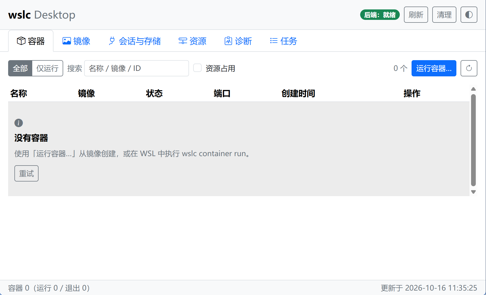
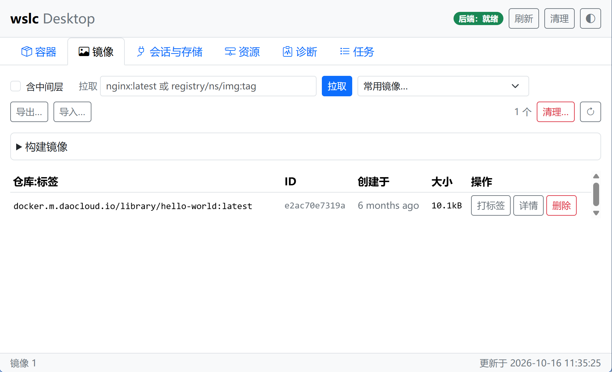
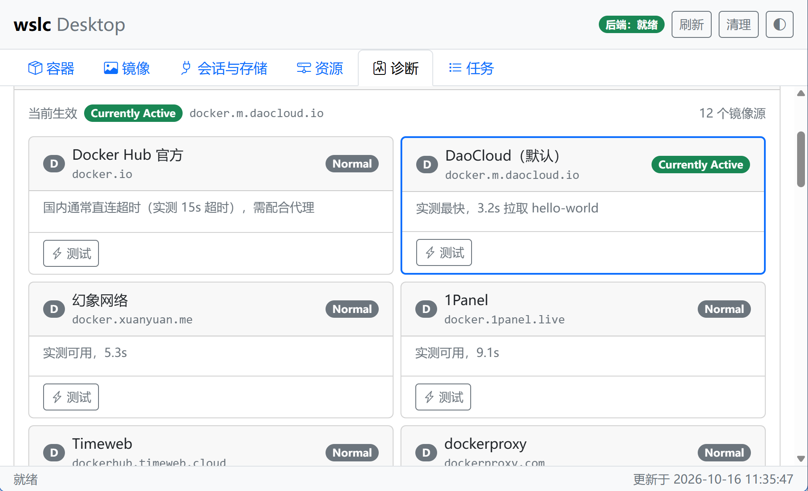
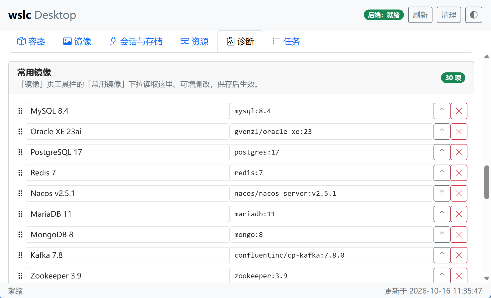

# Wslc Desktop

**用 Go + Wails 为 [wslc](https://learn.microsoft.com/en-us/windows/wsl/wsl-container) 写的 Windows 桌面管理工具。**

`wslc.exe` 是微软随 WSL ≥ 2.9.3 分发的 Linux 容器 CLI，可以在 Windows 上构建、运行和管理 Linux 容器，**无需 Docker Desktop**。本项目把它的核心操作包装成图形界面，并补齐 wslc 缺失的镜像源配置能力。

## 截图

| 容器 | 镜像 |
| --- | --- |
|  |  |
| **镜像源卡片墙** | **常用镜像预设** |
|  |  |

## 亮点

- **零前端构建**：纯静态 HTML/CSS/JS，没有 npm、没有 webpack。产物约 12 MB 单文件 exe。
- **零 Go 依赖注入**：后端只用标准库 + Wails v2，`internal/service` 不 import Wails，可纯 Go 测试。
- **完整能力**：容器 / 镜像 / 会话与存储 / 资源 / 诊断 / 任务 六个视图；日志跟随 + 交互式终端抽屉；破坏性操作二次确认。
- **镜像源改写 + 常用镜像预设**：绕过 wslc 上游缺失的 registry mirror 配置（[microsoft/WSL#40951](https://github.com/microsoft/WSL/issues/40951)），内置 12 个镜像源（可探测、可自定义）与 30 条常用镜像预设，解决国内直连拉取失败的问题。

## 系统要求

| 组件 | 最低要求 | 已验证版本 |
| --- | --- | --- |
| Windows | 11（含 WebView2 Runtime） | — |
| WSL | ≥ 2.9.3（提供 `wslc.exe`） | **3.0.3.0**（2026-10-09 发布） |
| Go（构建） | ≥ 1.25 | 1.25.x |
| Wails CLI（构建） | v2.16.0 | v2.16.0 |

> **适配版本说明**：本项目针对 `wslc` 3.0.1 实测开发，并已逐项核对 **wslc 3.0.3.0**（随 WSL 3.0.3 分发）的全部命令行契约——容器 / 镜像 / 卷 / 网络 / 会话 / 诊断各子命令使用的 flag（`--format`、`--all`、`--time`、`--timeout`、`--signal`、`--force`、`--volumes`、`--follow`、`--tail`、`--timestamps`、`--since`、`--until`、`--interactive`、`--tty`、`--user`、`--workdir`、`--env`、`--driver`、`--subnet`、`--gateway`、`--internal`、`--file`、`--tag`、`--build-arg`、`--target`、`--no-cache`、`--pull`、`--label`、`--progress` 等）在 3.0.3 中均无变更，表头本地化与 JSON/NDJSON 输出格式兼容，无需改动即可使用。后续 wslc 新版本若破坏性变更命令行契约，请提 issue。

**运行前提：容器服务必须可用。** wslc 通过 HCS 创建会话 VM，必须让 `vmcompute` 服务处于运行状态，否则容器命令会报 `HCS_E_SERVICE_NOT_AVAILABLE`：

```powershell
# 需要管理员身份的 PowerShell
Set-Service -Name vmcompute -StartupType Manual
Start-Service vmcompute
```

> 不需要安装任何 WSL 发行版（`wsl -l -v` 为空是正常的），也不需要完整 Hyper-V 角色或 Docker Desktop。

## 构建

```powershell
go install github.com/wailsapp/wails/v2/cmd/wails@v2.16.0
git clone https://github.com/dhshu/wslc-desktop.git
cd wslc-desktop
wails build -s
```

产物：`build\bin\wslc-desktop.exe`（约 12 MB）。

## 测试

```powershell
go test ./... -count=1                         # 单元测试
go test -tags integration ./... -count=1       # 对真实 wslc 的集成测试
node frontend/tools/selfcheck.mjs              # 前端自测（方法签名、DOM id）
node frontend/tools/smoke.mjs                  # 前端冒烟测试
```

## 架构

```
main.go              Wails 入口：窗口、内嵌前端资源、绑定 App
app.go               装配层：持有 service，转发绑定方法
frontend/            纯静态 HTML/CSS/JS（无打包器、无 npm 依赖）
internal/
  domain/            读模型（Container / Image / Volume / Network / Stats / SystemInfo）
  wslc/              CLI 适配层：Resolver / ExecRunner / 解析器 / 错误分类
  service/           业务编排：校验 → 构造命令 → 执行 → 解析 → 事件广播
  integration/       端到端测试（-tags integration）
docs/                PLAN.md / CONTRACT.md / ENVIRONMENT.md / VERIFICATION.md
```

分层原则：`internal/wslc` 只把命令变成结构化输出；`internal/service` 不 import Wails，可纯 Go 测试；所有命令都通过参数数组交给 `exec.Command`，**从不拼接 shell 字符串**。前后端契约冻结在 [docs/CONTRACT.md](docs/CONTRACT.md)。

## 文档

- [docs/PLAN.md](docs/PLAN.md) — 调研结论、架构、里程碑、测试策略
- [docs/CONTRACT.md](docs/CONTRACT.md) — 冻结的跨模块契约
- [docs/ENVIRONMENT.md](docs/ENVIRONMENT.md) — 实测的环境事实与踩坑点
- [docs/VERIFICATION.md](docs/VERIFICATION.md) — 独立对抗性验证报告

## 参考

- [WSL container 概览](https://learn.microsoft.com/en-us/windows/wsl/wsl-container)
- [microsoft/WSL#40951 — 请求支持 registry mirror](https://github.com/microsoft/WSL/issues/40951)
- [microsoft/WSL#8693 — HCS_E_SERVICE_NOT_AVAILABLE](https://github.com/microsoft/WSL/issues/8693)
- [Wails v2 文档](https://wails.io/docs/gettingstarted/installation/)

## 贡献

欢迎 issue 和 PR。改动前后端契约需同步更新 [docs/CONTRACT.md](docs/CONTRACT.md) 与相关测试；本地请先跑 `go test ./...` 与 `node frontend/tools/selfcheck.mjs`；破坏性操作必须走二次确认框。

## 许可

[MIT](LICENSE)。

---

> **说明**：本项目的全部代码均由 AI 助手在人工提示与审阅下生成。作者负责需求澄清、事实核验、代码审阅与最终发布。
